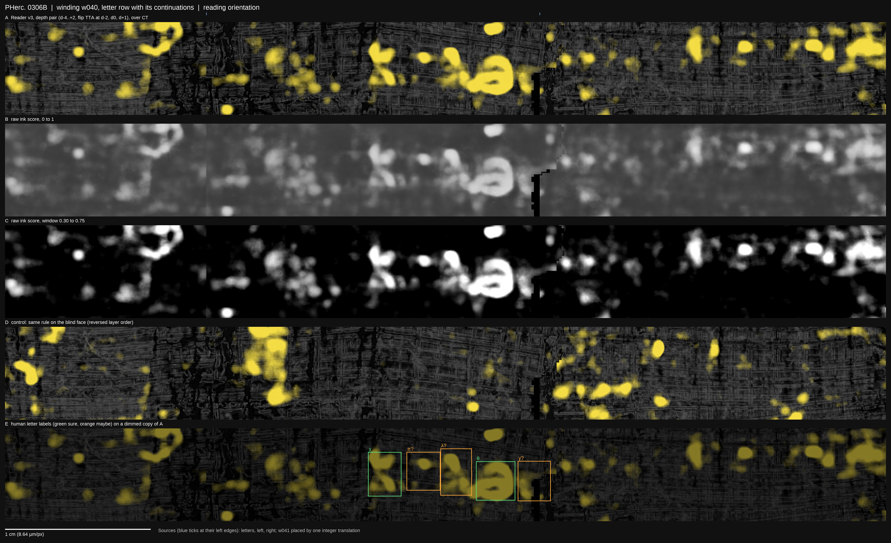

# PHerc. 0306B, winding w040: a row of letters, with segments, labels and predictions

**Team:** David de Meij, Nicolas Brown, Nataliia Bazaka.

We found a row of letters on winding w040 of PHerc. 0306B, in the lower block of the scan (z 6912–9216, scan
`20250521133212`, 8.64 µm). This repository releases everything needed to check it, reuse it or build on it:

- **Segments:** the w040 surface the letters sit on, and the next winding's surface (w041), which continues the same
  sheet to the right.
- **Labels:** five human-marked letters (two sure, three uncertain), with exact boxes.
- **Predictions:** raw Reader v3 ink probabilities at seven depths, on both faces, for the letter row and its
  continuations to the left and right. Both a single-depth and a depth-combined map are included.
- **Figures:** the stitched row in reading orientation, with raw-probability views and a blind-face control.



## The letters

The labels were marked by a human (David de Meij) on Reader v3 depth-0 maps on 22 October 2026. They are
observations, not model output.

| Letter | Confidence | Box (w040 flat px, x0 y0 x1 y1) | Size (mm, w × h) |
|---|---|---|---|
| χ | sure | 5061 2344 5326 2697 | 2.29 × 3.05 |
| π | maybe | 5367 2343 5636 2650 | 2.32 × 2.65 |
| λ | maybe | 5636 2316 5886 2690 | 2.16 × 3.23 |
| θ | sure | 5919 2418 6231 2730 | 2.70 × 2.70 |
| γ | maybe | 6251 2415 6513 2735 | 2.26 × 2.76 |

The 3-D centre of the marked area is (x, y, z) = (5166, 4399, 8345) voxels. Boxes are in `labels/letters.json`, and
in the figure's frame in `labels/letters_in_figure.json`.

**More ink in the same row.** Left of χ, and on the w041 continuation 1.5–3 cm right of γ, the same row carries more
ink. It is fainter and more fragmented, and we have not labelled it. The w041 side also shows blobs on the blind face,
so read it with that control in mind.

## Layout

```
segments/      w040.tifxyz, w041.tifxyz         tifxyz (x/y/z.tif, meta.json); one node = 20 voxels
labels/        letters.json, letters_in_figure.json
predictions/   w040-letters/  w040-left/  w041-right/
               readerv3_d{-4..+2}.tif, readerv3_d{..}_blind.tif   raw Reader v3, uint8 (255 = probability 1)
               readerv3_depthpair.tif, readerv3_depthpair_blind.tif
               README.json   frame (flat-px origin), window, model and volume pins
figures/       PHerc0306B_w040-letters.png, panel_A..E.png, stitch.json
code/          stitch_w040.py, make_w040_figure.py, depthpair.py
```

## How it was made

1. **Surface.** w040 and w041 are windings from a lasagna spiral fit (villa `fit_spiral`) of the z 6912–9216 block,
   flattened and snapped to the organisers' m7 surface prediction.
   - The fit exports one mesh per winding, cut at a fixed angle around the scroll axis. That cut is why w040 ends just
     after γ; the same sheet continues as w041.
   - At w040's right edge, w041 matches it with a median residual of about 2 voxels (18 µm).
   - In the figure, w041 is placed by one integer translation of (5466, 187) flat px. There is no warping or blending,
     and a gap of about 0.3 mm remains at the join.
2. **Rendering.** 66 layers along the surface normal, 1 voxel apart, sampled from level 0 of the public masked volume.
3. **Ink.** Reader v3 (HF `domenicor046/reader-v3` @aee1d64, sha256 `ea405417…`) at depth offsets −4 to +2 voxels.
   It was run on both faces: reading, and blind (reversed layer order).
4. **Depth pair.** The depth at which ink is clearest varies along the row, so we keep, per pixel, the best mean of two
   adjacent depths. A stroke seen at two neighbouring depths keeps its strength; a blob seen at one depth is halved.
   Before pairing, each depth is averaged over 8 flips/transposes at d−2, d0 and d+1. The same rule runs on the blind
   face as a control (`code/depthpair.py`).
5. **Display.** Light yellow over the mean of CT layers 31–35, dimmed to 32 %, with no threshold. The figure also shows
   the raw score in grey at 0–1 and windowed to 0.30–0.75.

## Checks

- **Blind-face control.** On the blind face, the same rule shows scattered blobs but none of the row's letter shapes
  (panel D).
- **Reading orientation.** This was checked geometrically. In w040's flat frame, z increases downwards and the winding
  angle around the scroll axis increases to the right, the same as on our W073 page, whose reading was confirmed
  independently. The images are shown unrotated.
- **Sheet placement**, from the CT profile along the normal in papyrus without ink around each letter:
  - our sheet lies within 1–4 voxels of the surface;
  - the neighbouring sheets lie 11–13 voxels inwards and 17–20 voxels outwards;
  - the strokes are brightest on the outer face of our sheet, at +3 to +9 voxels.

  This is consistent with the ink being on w040's own sheet. χ, at about half the distance to the outer neighbour, is
  the least certain.

## Limits

- **Five letters, three of them uncertain.** This is not a reading. We make no claim about the text.
- **The right continuation is not a new surface.** It is the existing w041 surface, translated once. A dedicated
  reconstruction of the join could sharpen it.
- **All predictions come from one model, Reader v3.** Other public 9 µm models (Reader v2, dense-native, ink_9um,
  v8-in) were noisier on this scroll in our tests.

## Reproduce

The code in `code/` is the code that ran in our lab repository; paths are relative to it.

```bash
python code/depthpair.py OUT --map=-4=predictions/w040-letters/readerv3_d-4.tif ...   # see the script's docstring
```

**Licence.** Code: MIT. Data, figures and labels: CC BY-NC 4.0, derived from Vesuvius Challenge open data. See
`DATA_LICENSE.md`.
